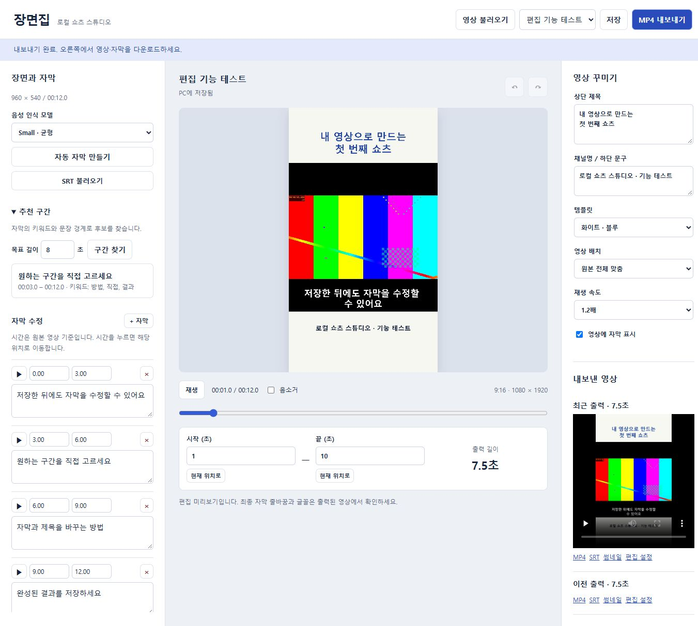
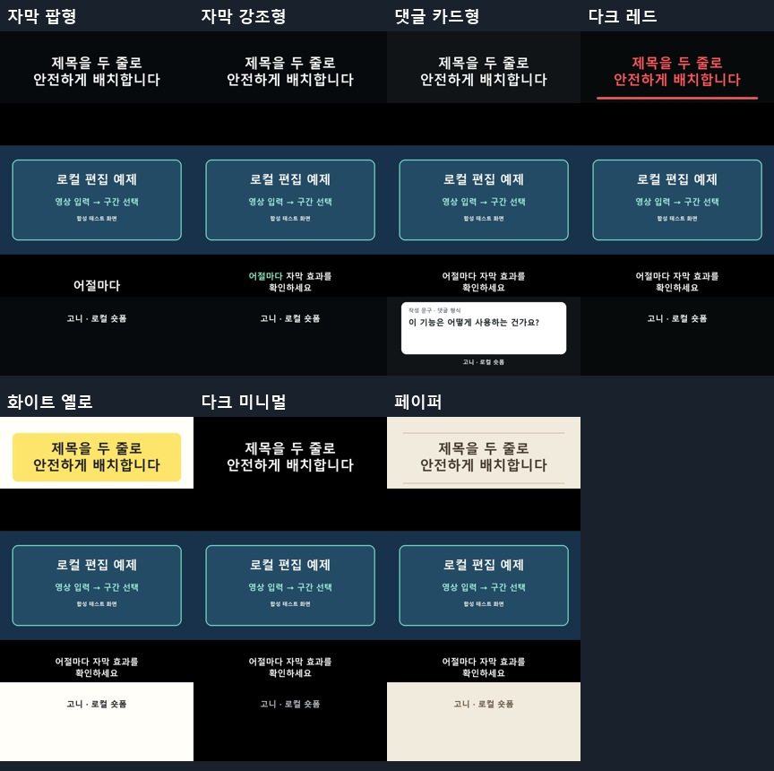

# 고니 숏폼 하이라이트

프롬프트와 영상 링크 또는 롱폼 파일로 하이라이트를 구성하는 **Codex·Claude용 워크플로 + Windows 로컬 편집기 ‘장면집’**입니다.



## 장면집 없이 실행

[고니 독립 영상 엔진](docs/standalone-reel.md)은 브라우저·웹 서버 없이 CLI 또는 Codex·Claude MCP로 원본 → 편집 → MP4를 처리합니다. `goni_reel.py`가 한 번에 출력하며, MCP 기본 모드도 직접 실행입니다.

**처음이라면:** [상황별 프롬프트 4가지](prompts/README.md)에서 BAT 만들기, 영상 제작, 자막 영상, 수정 중 하나만 골라 복사하세요.

**Windows Claude 실행기:** [BAT 더블클릭 사용법](launcher/사용법.md). Claude Code·FFmpeg·고니 MCP 설치와 로그인 확인 후 영상 경로를 입력하면 Claude 세션이 시작됩니다. 기본 권한 확인을 유지합니다.

**영상 글자·소리 정리:** [초보자 설치 및 사용법](docs/video-cleanup.md). 링크나 파일을 넣고 자동 글자 지우기, 목소리 또는 배경음악 분리, 전체 무음을 선택합니다. 자동 복원과 소리 분리 품질은 영상마다 달라 결과 확인이 필요합니다.

## 무엇을 할 수 있나요?

**새 기능: [릴스 다중 장면 편집 + MCP](docs/reel-studio.md)** — 한 원본의 여러 구간 연결, 장면별 배속·확대·명암·반전·플래시, 가로/세로 MP4 출력. 기본 자막 편집기와 별도 화면(`/reel`)으로 제공하며 Codex·Claude Code용 `goni-reel` MCP와 CLI를 연결합니다. [릴스 스킬](skills/goni-reel-studio/SKILL.md).

- 에이전트: 전체 자막을 읽고 요청에 맞는 후보·타임코드·훅·선정 이유·자막·썸네일 문구를 구성합니다.
- 편집기: 로컬 영상, Whisper 한국어 자막, SRT 편집, 규칙 기반 후보 추천, 단일 구간/배속, 제목/하단 문구, 템플릿 11종(기존 4종 + 신규 7종), 9:16 미리보기.
- 출력: 1080×1920 H.264/AAC MP4, SRT, 첫 프레임 JPG, 편집 설정. 이전 출력 버전과 원본을 보존합니다.
- 도우미: 자막 준비와 **에이전트가 선정한** 여러 후보를 순서대로 출력합니다.

앱 자체에 영상만 넣으면 AI가 여러 쇼츠를 자동 선정·완성하는 기능은 아직 없습니다. 맥락 판단은 Codex·Claude가 수행하며, 앱의 추천은 규칙 기반입니다. 별도 브랜드 썸네일은 에이전트가 이미지 도구로 제작·검수해야 합니다. 편집 흐름과 템플릿은 조사한 화면을 바탕으로 독립 구현했으며 외부 서비스의 서버 AI·코드·브랜드 자산은 포함하지 않습니다. [기술 출처 고지](THIRD_PARTY_NOTICES.md).

## 바로 시작

Windows, Python 3.11 이상, FFmpeg/ffprobe가 필요합니다. 한글 출력은 Windows 맑은 고딕을 사용합니다. FFmpeg 실행 파일을 PATH에 등록하세요.

```powershell
git clone https://github.com/qwer777qq/goni-shortform-highlights.git
cd goni-shortform-highlights
python -m venv .venv
.\.venv\Scripts\python -m pip install -r local_studio/requirements.txt
.\.venv\Scripts\python local_studio/make_demo.py
.\.venv\Scripts\python local_studio/server.py
```

브라우저에서 http://127.0.0.1:8767 을 여세요. 이 주소는 실행한 PC에서만 접속하는 주소이며 GitHub가 편집 서버를 호스팅하지 않습니다. 데모는 테스트 패턴과 신호음입니다.

자동 자막을 처음 쓸 때 모델을 한 번 내려받으세요. 이후 음성 인식은 로컬 캐시를 사용합니다.

```powershell
.\.venv\Scripts\python -c "from faster_whisper import WhisperModel; WhisperModel('small', device='cpu', compute_type='int8')"
```

YouTube 가져오기는 온라인 선택 기능이며 원격 제한에 따라 실패할 수 있습니다. 그때는 사용 가능한 로컬 영상 또는 타임코드 자막으로 진행하세요.

## Codex·Claude에 요청하기

[복사용 마스터 프롬프트](prompts/master-prompt.ko.md)를 붙여 넣고 영상 링크나 파일을 제공하세요. 실제 영상·파일·셸 도구 접근이 없는 환경에서는 구성까지만 가능하며, 이 저장소가 그 권한을 자동 연결하지는 않습니다.

```text
이 저장소의 고니 숏폼 하이라이트 스킬을 적용해줘.
영상: [링크 또는 첨부한 롱폼]
목적: 초보자에게 핵심 기능과 실제 시연 전달
길이/개수: 35~60초, 서로 다른 관점으로 3개
요청: 전체 맥락과 실제 타임코드로 선정하고,
훅·자막·썸네일을 구성한 뒤 가능한 환경에서 MP4까지 출력·검수해줘.
```

Codex 설치: `skills/goni-shortform-highlights`와 `skills/goni-rea` 폴더를 사용자 스킬 폴더에 복사하거나, 해당 SKILL.md를 직접 읽도록 요청하세요. Claude에서는 `CLAUDE.md`와 원하는 스킬 문서를 읽도록 요청하세요. 설치 위치·자동 검색은 사용하는 클라이언트의 지원 방식에 따릅니다.

## 제목이 긴 쇼츠 만들기

새 프로젝트는 **다크 · 제목 안전형** 템플릿으로 시작합니다. 이 템플릿은 제목을 단어 단위로 나누고 글자 크기를 조절해 1080×1920 화면의 상단 검은 영역에 최대 두 줄로 배치합니다. 기존 프로젝트에서 선택한 템플릿은 그대로 유지되며, 필요하면 ‘영상 꾸미기 → 템플릿’에서 안전형으로 바꿀 수 있습니다.

제목이 화면 경계에 닿거나 너무 작아지면 문구를 짧게 고친 뒤 MP4 첫 화면과 내려받은 썸네일을 확인하세요. 미리보기의 글꼴과 최종 출력은 다를 수 있습니다. 자동 줄바꿈은 내용의 정확성이나 플랫폼 표시 영역까지 보장하지 않습니다.

## 구성

| 경로 | 용도 |
|---|---|
| `local_studio/` | 로컬 웹 편집기와 미디어 파이프라인 |
| `skills/goni-shortform-highlights/` | 맥락 기반 구성·썸네일·검수 워크플로와 실행 도우미 |
| `skills/goni-rea/` | REA 증거 분석→독립 구현 워크플로 |
| `prompts/master-prompt.ko.md` | Codex·Claude 공통 입력 프롬프트 |
| `docs/verification.md` | 검증 범위와 한계 |

## 제한

현재 Windows용입니다. 단일 연속 구간만 편집하며, 비연속 장면 연결·자동 얼굴 추적·댓글 이미지·플랫폼 자동 게시는 없습니다. 긴 영상은 변환/음성 인식에 시간이 걸리고 작업 취소·재시작 복구는 아직 지원하지 않습니다. 음성 인식 오류와 자막·컷 경계는 사람이 검수해야 합니다. 조회수나 성과를 보장하지 않습니다.

영상·자막·모델·사용자 프로젝트·키·토큰은 이 저장소에 포함하지 않습니다. 자신의 영상 데이터는 `local_studio/data/`에 저장됩니다.

## 검증

```powershell
python -m unittest discover -s local_studio/tests -v
python local_studio/smoke_test.py
node --check local_studio/static/app.js
```

첫 두 명령은 Python/FFmpeg/Pillow가, 마지막 명령은 Node.js가 필요합니다. 검증 세부와 미검증 항목은 [검증 기록](docs/verification.md)을 확인하세요.

## 출처와 라이선스

고니 응용 코드·스킬은 [MIT](LICENSE)로 공유합니다. REA 엔진은 **[morluto/rea](https://github.com/morluto/rea)** 프로젝트(MIT)이며 이 저장소에 포함하지 않습니다. REA 설치/연결은 별도입니다. 종속 라이브러리와 원본 영상의 권리는 각 권리자에게 있습니다. [출처 안내](THIRD_PARTY_NOTICES.md).

## 템플릿 살펴보기 (총 11종)

[전체 갤러리·사용법·검증 범위](docs/templates/README.md)에서 자막 팝형, 자막 강조형, 댓글 카드형, 다크 레드, 화이트 옐로, 다크 미니멀, 페이퍼의 실제 출력 예제를 확인하세요. 모두 독립 구현이며 기존 프로젝트의 4종 설정은 유지됩니다.


